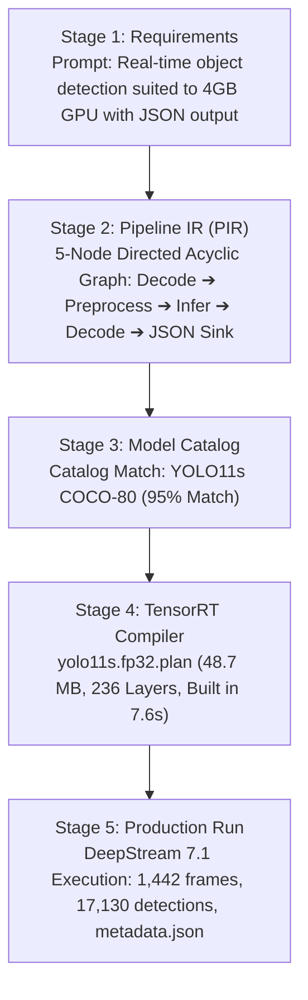

# Real-Time Edge Visual Perception & Telemetry Pipeline
**HackwithBangalore 4.0 — Track A: CraftifAI PipeGen (Perception)**

---

## 1. Project Overview & Problem Statement

### Theme: Physical AI Systems That See, Decide and Act
Deploying computer vision models on resource-constrained physical edge devices often requires weeks of manual, low-level C/C++ engineering, complex GStreamer/DeepStream pipeline wiring, and hardware-specific TensorRT optimization passes. 

This project demonstrates an end-to-end Physical AI perception pipeline built using **PipeGen v0.5.1** (by CraftifAI). Rather than writing manual pipeline boilerplate or standalone scripts, the entire pipeline—from natural language requirement to a production-ready, hardware-accelerated DeepStream application—was generated, compiled, and executed on physical hardware using PipeGen's multi-agent workflow.

### Core Objectives
1. **Full 5-Stage PipeGen Flow:** Guided entirely through PipeGen's native flow: Requirements ➔ Pipeline IR ➔ Model Selection ➔ Compiler ➔ Live Execution.
2. **TensorRT Compilation on Hardware:** Compiling an ONNX vision model (`yolo11s.onnx`) into a TensorRT 10.3.0 engine (`yolo11s.fp32.plan`) optimized for an NVIDIA RTX 2050 GPU.
3. **Actionable Telemetry Generation:** Ingesting 720p H.264 video and emitting structured per-frame JSON telemetry (`output/metadata.json`) containing timestamps, frame IDs, object classes, bounding boxes, and confidence scores for downstream decision-making.
4. **Live Execution:** Running live on physical GPU hardware inside DeepStream with visual bounding box overlays.

---

## 2. Hardware & Environment Specifications

The entire pipeline was verified and executed on physical hardware:

| Component | Verified Specification |
| :--- | :--- |
| **System** | Windows 11 Laptop, 12th Gen Intel Core i5-12450H (12 vCPUs, 7.6 GiB RAM) |
| **GPU** | NVIDIA GeForce RTX 2050 Laptop GPU (4096 MiB VRAM) |
| **Host NVIDIA Driver** | 581.83 (CUDA 13.0) |
| **Linux Subsystem** | Ubuntu 24.04.4 LTS on WSL2 (Kernel 6.6.87.2-microsoft-standard-WSL2) |
| **Display Server** | X11 / WSLg (`DISPLAY=:0`, socket `/tmp/.X11-unix/X0`) |
| **Container Engine** | Docker Engine v29.1.3 + containerd v2.2.1 |
| **NVIDIA Container Toolkit**| NVIDIA Container Toolkit CLI v1.20.1 (`nvidia-ctk`) |
| **Base Image** | `craftifaidocker/deepstream:7.1-amd64-v3` (38 GB unpacked) |
| **Main Tool** | PipeGen v0.5.1 (`/opt/PipeGen`, CraftifAI Orbit) |

Full system verification logs are preserved in [`evidence/environment.txt`](evidence/environment.txt) and [`evidence/gpu_specs.csv`](evidence/gpu_specs.csv).

---

## 3. The 5-Stage PipeGen Perception Workflow



### Stage 1: Requirements (Describing the Physical AI Goal)
- **Goal Statement:** *"Real-time object detection pipeline that reads a video file, detects objects with a small model suited to a 4 GB GPU, and outputs detections as JSON."*
- **Scene Configuration:** Fixed camera mount, medium/large target scale, standard COCO-80 categories (vehicles and pedestrians).
- **Inputs Configured:** `sample_720p.mp4` (1280x720 H.264 stream).
- **Outputs Configured:** `output/metadata.json` (Structured JSON telemetry).
- **Result:** All 10 PipeGen requirement verification checks passed.
- **Evidence:** [`evidence/screenshots/stage1_requirements.png`](evidence/screenshots/stage1_requirements.png), [`stage1_final_flow.png`](evidence/screenshots/stage1_final_flow.png).

### Stage 2: Pipeline IR (Intermediate Representation)
- PipeGen mapped the natural language requirements into a multi-node Pipeline IR:
  - Node 1 (`p01`): Hardware-accelerated demuxing and H.264 video decoding.
  - Node 2 (`p02`): Frame preprocessing (RGB color conversion, letterbox resize to 640x640, normalization to [0, 1]).
  - Node 3 (`p03`): Hardware TensorRT inference engine.
  - Node 4 (`p04`): YOLO11s detection decoding and non-maximum suppression (NMS).
  - Node 5 (`p05`): JSON serialization and metadata file output sink.
- **Evidence:** [`evidence/screenshots/stage2_pir_nodegraph.png`](evidence/screenshots/stage2_pir_nodegraph.png), [`evidence/benchmarks/PipelineIR.json`](evidence/benchmarks/PipelineIR.json).

### Stage 3: Model Selection
- PipeGen searched its curated model catalog and identified **`A) VehicleDetection (Suggested)`** with a **95% match**.
- Architecture: Compact **YOLO11s** ONNX model trained on COCO-80, optimized for low VRAM footprints on edge GPUs.
- Compatibility: PipeGen ran an automated operator audit on `yolo11s.onnx` confirming 100% operator compatibility with TensorRT.
- **Evidence:** [`evidence/screenshots/stage1_catalog_match.png`](evidence/screenshots/stage1_catalog_match.png), [`evidence/screenshots/stage3_onnx_model_check.png`](evidence/screenshots/stage3_onnx_model_check.png).

### Stage 4: TensorRT Compilation & Speed Report
- PipeGen compiled `yolo11s.onnx` using TensorRT 10.3.0 specifically targeted to the **NVIDIA GeForce RTX 2050** architecture.
- **Exact Compilation Metrics (From PipeGen Logs):**
  - **Engine File:** `yolo11s.fp32.plan`
  - **Precision:** FP32 (235 FP32 layers, 1 fallback layer)
  - **Engine Size:** **48.7 MB** (48,709,532 bytes)
  - **TensorRT Layers:** **236 layers** (85 CaskConvolution, 83 PointWiseV2, 40 Reformat, 10 NoOp, 4 kgen, 3 CaskPooling, 3 Constant, 2 GEMM, 2 Resize, 2 Shuffle, 1 CaskSoftMaxV2)
  - **Build Time:** **7.6 seconds**
  - **Coverage:** **87%** (205 matched layers, 31 engine-only optimizations, 5 model-only)
  - **Model vs Measured Speedup:** **1.54x**
- **Evidence:** [`evidence/screenshots/stage4_benchmark_report.png`](evidence/screenshots/stage4_benchmark_report.png).

### Stage 5: Production Packaging & Live Hardware Run
- PipeGen automatically compiled custom C++ parser plugins (`libconfig_det_pgie_parser.so`) and metadata serializers (`libmeta_json.so`), outputting 9 deployment files.
- Executed live inside DeepStream 7.1 on `sample_720p.mp4`.
- **Evidence:** [`evidence/screenshots/stage5_live_execution.png`](evidence/screenshots/stage5_live_execution.png).

---

## 4. Real Results & Telemetry Audit

All statistics below were computed directly from the generated [`evidence/output/metadata.json`](evidence/output/metadata.json) log file:

### Execution Summary
- **Total Frames Processed:** **1,442 frames**
- **Total Objects Detected:** **17,130 detections**
- **Telemetry File Size:** **2.9 MB**

### Class Breakdown & Detection Accuracy
| Detected Class | Detection Count | Average Confidence |
| :--- | :---: | :---: |
| **Car** | 10,239 | 64.6% |
| **Person** | 5,553 | 64.8% |
| **Truck** | 562 | 53.9% |
| **Bus** | 243 | 78.8% |
| **Bicycle** | 217 | 58.0% |
| **Backpack** | 198 | 56.3% |
| **Skateboard** | 75 | 35.7% |
| **Bench** | 15 | 39.2% |
| **Handbag** | 13 | 37.8% |

### Sample Telemetry Record (`metadata.json`)
```json
{
  "frame": 32,
  "source_id": 0,
  "pts_ns": 1133333333,
  "width": 1280,
  "height": 720,
  "objects": [
    {
      "class_id": 2,
      "label": "car",
      "confidence": 0.9159,
      "bbox": {
        "left": 647.3,
        "top": 324.0,
        "width": 129.0,
        "height": 65.7
      }
    },
    {
      "class_id": 0,
      "label": "person",
      "confidence": 0.8724,
      "bbox": {
        "left": 244.7,
        "top": 309.9,
        "width": 96.4,
        "height": 204.8
      }
    }
  ]
}
```

---

## 5. Repository Structure
```
├── README.md                              # This comprehensive report
├── record_evidence.sh                     # System & hardware audit script
├── analyze_telemetry.py                   # Automated JSON telemetry statistical auditor
├── evidence/
│   ├── environment.txt                    # Verified OS, Docker, GPU & PipeGen logs
│   ├── gpu_specs.csv                      # GPU hardware capacity specifications
│   ├── output/
│   │   └── metadata.json                  # 2.9 MB per-frame structured JSON telemetry (1,442 frames)
│   ├── benchmarks/
│   │   └── PipelineIR.json                # Complete Pipeline IR architecture definition
│   └── screenshots/                       # Verifiable visual evidence across all 5 stages
│       ├── stage1_requirements.png        # Stage 1: Requirement prompt
│       ├── stage1_step2_inputs.png        # Stage 1: Video file mapping
│       ├── stage1_step4_scene.png         # Stage 1: Camera & scene settings
│       ├── stage1_step5_flow_draft.png    # Stage 1: Architecture flow draft
│       ├── stage1_final_flow.png          # Stage 1: Flow locked
│       ├── stage1_step7_sources.png       # Stage 1: Catalog source selection
│       ├── stage1_catalog_match.png       # Stage 1: 95% match on YOLO11s
│       ├── stage2_pir_nodegraph.png       # Stage 2: Pipeline IR Node Graph (Mandatory)
│       ├── stage3_onnx_model_check.png    # Stage 3: ONNX operator validation
│       ├── stage4_model_compilation_started.png # Stage 4: TensorRT compile start
│       ├── stage4_benchmark_report.png    # Stage 4: TensorRT speed report (Mandatory)
│       ├── stage5_pipeline_compiling.png  # Stage 5: DeepStream pipeline compilation
│       ├── stage5_pipeline_ready.png      # Stage 5: 9 deployment files ready
│       └── stage5_live_execution.png      # Stage 5: Live GPU DeepStream execution
├── pipeline_export/                       # Production files generated by PipeGen
│   ├── run.sh                             # Deployment launch script
│   ├── run.debug.sh                       # GStreamer debug pipeline
│   ├── run.vms.sh                         # Multi-stream VMS pipeline
│   ├── configs/                           # DeepStream inference configs
│   ├── parsers/                           # Custom YOLO C++ parsing plugins
│   ├── labels/                            # COCO-80 label mapping
│   └── build/                             # Compiled parser & JSON sink shared libraries (.so)
└── input_videos/
    └── sample_720p.mp4                    # Benchmark test video
```

---

## 6. Edge Performance & Limitations Analysis
- **VRAM Headroom:** The YOLO11s engine requires only **48.7 MB** of storage and runs well within the 4096 MiB VRAM boundary of the laptop RTX 2050 GPU, leaving substantial headroom for multiple concurrent video channels or edge micro-services.
- **Precision Trade-off:** FP32 full-precision inference achieved a 1.54x speedup with 87% layer coverage. For ultra-low-power deployments (e.g., NVIDIA Jetson Orin Nano), quantizing to INT8 using PipeGen's calibration wizard would offer further power efficiency and latency reductions.
- **Edge Deployment Ready:** The generated package contains self-contained GStreamer plugins (`libmeta_json.so`, `libconfig_det_pgie_parser.so`), allowing deployment to any NVIDIA DeepStream container or JetPack edge device without relying on Python runtimes.

---

## 7. How to Reproduce
1. **Clone the repository:**
   ```bash
   git clone <repo-url>
   cd <repo-folder>
   ```
2. **Verify Hardware Environment:**
   ```bash
   ./record_evidence.sh
   ```
3. **Execute the PipeGen Pipeline:**
   ```bash
   cd pipeline_export
   bash run.sh
   ```
4. **Inspect Live JSON Telemetry:**
   ```bash
   python3 ../analyze_telemetry.py
   ```
